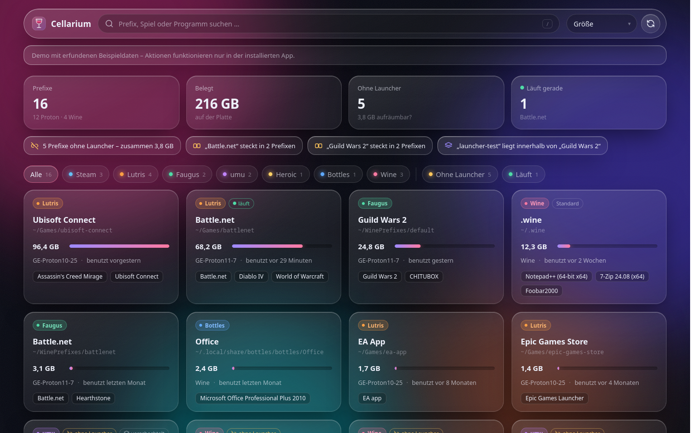

# Cellarium

Alle Wine- und Proton-Prefixe auf einen Blick. Cellarium sucht die Prefixe auf dem Rechner zusammen und
zeigt für jeden, welcher Launcher ihn benutzt, was darin installiert ist und wie groß er ist. Außerdem
sieht man, welche Prefixe keinem Launcher mehr gehören und nur noch Platz belegen.

**[Projektseite mit Live-Demo](https://gamunex.github.io/cellarium/)**



## Was es kann

- **Findet Prefixe überall:** durchsucht das Home-Verzeichnis (Tiefe 6) und fragt **Steam** (alle
  Bibliotheken), **Lutris**, **Faugus**, **Heroic** und **Bottles**, wem welcher Prefix gehört. Prefixe von
  umu bzw. Proton werden als solche erkannt.
- **Zeigt, was drin ist:** installierte Programme aus den Uninstall-Schlüsseln der Registry (so wie
  „Apps & Features“ unter Windows), getrennt von Laufzeitbibliotheken wie VC++, Mono oder WebView2. Dazu kommen
  winetricks-Verben, Proton-Version, Architektur, Größe und wann der Prefix zuletzt benutzt wurde.
- **Hinweise:** Prefixe ohne Launcher, Programme, die in mehreren Prefixen stecken, und Prefixe, die in einem
  anderen Prefix liegen.
- **Aktionen:** Ordner öffnen, eine `.exe`/`.msi` starten, `winecfg`, `winetricks`, Registry-Editor,
  Deinstallieren, laufende Wine-Prozesse beenden und den Prefix in den Papierkorb verschieben.
- **Eigene Angaben:** Name, Notiz, Ausblenden und Runner lassen sich pro Prefix festlegen.

## Installieren

Benötigt nur Python 3.10 oder neuer, sonst keine Abhängigkeiten.

```sh
git clone https://github.com/gamunex/cellarium.git
cd cellarium && ./install.sh
cellarium            # oder über das Startmenü
```

Aktualisieren mit `git pull && ./install.sh`, entfernen mit `./install.sh --uninstall`.

`cellarium` startet einen kleinen Server auf `127.0.0.1:47110` und öffnet die Oberfläche als App-Fenster im
ersten gefundenen Chromium-Browser (Brave, Chromium, Chrome, Vivaldi, Edge), sonst im Standardbrowser. Wird das
Fenster geschlossen, beendet sich der Server nach einer Minute. Optionen: `--browser`, `--port`,
`--no-window` und `--stay`.

## Wie die Aktionen laufen

Ein Proton-Prefix darf nicht mit System-Wine geöffnet werden und umgekehrt, denn Wine würde den Prefix sofort
auf seine eigene Version umstellen. Deshalb wählt Cellarium den Runner so:

1. den Runner, den du im Detailpanel von Hand festgelegt hast,
2. sonst bei Proton-Prefixen genau das Proton, das in `config_info` steht, also das, mit dem der Prefix
   angelegt wurde. Gestartet wird es über **umu-run** (aus Faugus, Lutris oder dem `PATH`), ohne umu über
   `proton run`,
3. sonst bei Lutris den eingetragenen Wine-Runner, sonst System-Wine.

Für einen Proton-Prefix ohne passenden Runner tut Cellarium lieber nichts und bittet darum, einen auszuwählen.

**Beenden** schickt allen Wine-Prozessen mit diesem `WINEPREFIX` ein SIGTERM und nach vier Sekunden ein
SIGKILL. **Papierkorb** nutzt `gio trash` bzw. `kioclient`, verlangt das Eintippen des Ordnernamens und
verweigert, solange im Prefix noch etwas läuft. Bei Steam und umu wandert der ganze `compatdata`-Ordner mit.

Die Ausgaben gestarteter Programme landen in `~/.cache/cellarium/logs/<id>.log`.

## Einstellungen

`~/.config/cellarium/config.json`:

```json
{
  "roots": ["~", "/mnt/games"],
  "maxDepth": 6,
  "exclude": ["~/Archiv"],
  "meta": {}
}
```

In `meta` speichert die Oberfläche Namen, Notizen und Runner-Wahl. Gemessene Größen liegen zwischengespeichert in
`~/.cache/cellarium/sizes.json`, damit die Übersicht beim Start sofort Zahlen zeigt.

## Sicherheit

Der Server hört nur auf `127.0.0.1`. Jede API-Anfrage braucht ein Token, das beim Start zufällig erzeugt und dem
Fenster im URL-Fragment übergeben wird. Anfragen mit fremdem `Host`-Header werden abgewiesen (Schutz gegen
DNS-Rebinding). Andere Webseiten im Browser können also keine Aktionen auslösen.

## Entwickeln

```sh
python3 -m cellarium --no-window --stay   # direkt aus dem Repo
python3 tools/make_demo.py                # Demo-Daten für die Projektseite neu erzeugen
```

Die Projektseite (`site/`) und die Demo (`cellarium/web/` mit `demo.json`) veröffentlicht
`tools/publish_site.sh` in den Branch `gh-pages`.

## Lizenz

GPL-3.0
